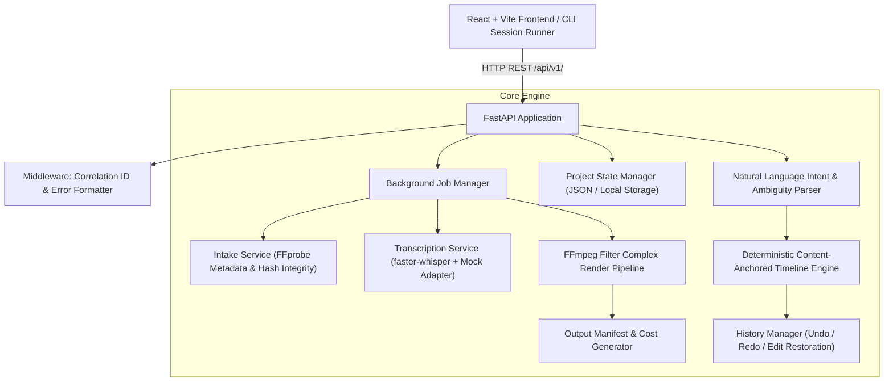

# IncuBrix AI — Prompt-Based Video Editing Engine

A production-minded prototype video editing service that converts plain-language instructions (*"cut out the ums, remove the part about pricing, add a caption on the intro"*) into exact, content-anchored, non-destructive video edits.

---

## 1. Core Architecture



### The Golden Rule: Edits Stick to Content
Edits bind to **transcript word tokens and content anchors**, never to fragile clock times. A caption added to *"welcome to the channel"* remains bound to those exact words after any preceding cuts, speed changes, reorderings, or restorations.

---

## 2. Setup in Under 10 Commands

### Option A: Local Python & Node Execution
```bash
# 1. Clone repository & enter workspace
git clone <repo-url> && cd Incubrix_prompt_based_video_editor

# 2. Install backend Python dependencies
pip install -r requirements.txt

# 3. Copy environment configuration
cp .env.example .env

# 4. Build React frontend
cd frontend && npm install && npm run build && cd ..

# 5. Run tests (15 unit, integration, and worked-example tests)
pytest -v

# 6. Execute CLI Batch Session Runner across all 15 test scenarios
python app/cli/session_runner.py test_pack/sessions/ --output-dir test_pack/batch_results

# 7. Start production server
uvicorn app.main:app --host 0.0.0.0 --port 8000
```

### Option B: Docker Compose (One-Command Startup)
```bash
docker compose up --build
```
Access the application UI at `http://localhost:8000` and API documentation at `http://localhost:8000/docs`.

---

## 3. How to Run Tests and Batch Runner

### Run Test Suite
```bash
# Runs all 15 test cases (Must-haves 1-7, 8-step worked example, hard cases, API standards)
pytest -v
```

### Run Batch Session Runner
```bash
# Run single session
python app/cli/session_runner.py test_pack/sessions/session_01_worked_example.yaml --output-dir ./results

# Run all 15 sessions in batch mode
python app/cli/session_runner.py test_pack/sessions/ --output-dir ./test_pack/batch_results
```

Each run outputs:
- `results.json`: Full trajectory with 3-way status (`applied`, `needs_clarification`, `rejected`), operations, summary, question, options, timeline hash, and duration.
- `final_timeline.json`: Canonical non-destructive timeline data model.
- `rendered_*.mp4`: Synchronized rendered video.
- `manifest_*.json`: Complete metadata manifest with model versions, timings, and cost breakdown.

---

## 4. Standard Error Codes Table (Integration Standard Point 5)

All errors follow the contract:
`{"error": {"code": "UPPER_SNAKE_CASE", "message": "...", "retryable": boolean, "details": any}}`

| Error Code | HTTP Status | Retryable | Description |
|------------|-------------|-----------|-------------|
| `FILE_TOO_LARGE` | 400 | No | File exceeds `MAX_UPLOAD_SIZE_BYTES` (500MB). |
| `INVALID_FILE_TYPE` | 400 | No | File extension is not permitted (.mp4, .mov, .mkv only). |
| `FILE_NOT_FOUND` | 404 | No | Media or output file not found on disk. |
| `PROJECT_NOT_FOUND` | 404 | No | Project ID does not exist in repository. |
| `EMPTY_TIMELINE` | 400 | No | Operation would remove all video segments (whole-video cuts are rejected). |
| `TIMELINE_OUT_OF_BOUNDS` | 400 | No | Requested timestamp range does not map to active segments. |
| `NOTHING_TO_UNDO` | 400 | No | Cannot undo: at the beginning of edit history. |
| `NOTHING_TO_REDO` | 400 | No | Cannot redo: redo stack is empty. |
| `INVALID_RESTORE_TARGET` | 400 | No | Specified step index is not a valid historical step. |
| `INSTRUCTION_REJECTED` | 400 | No | Instruction is impossible, contradictory, or exceeds safety limits. |
| `JOB_NOT_FOUND` | 404 | No | Background job ID does not exist. |
| `RENDER_FAILED` | 400 | Yes | FFmpeg pipeline encountered a processing failure. |
| `IDEMPOTENCY_CONFLICT` | 409 | No | Duplicate submission conflict with mismatched payload. |
| `INTERNAL_SERVER_ERROR` | 500 | Yes | Unexpected backend failure. |

---

## 5. Configuration Settings

| Setting | Default | Description |
|---------|---------|-------------|
| `APP_ENV` | `production` | Environment mode (`development` / `production`). |
| `PORT` | `8000` | HTTP port for API and frontend. |
| `TIME_POLICY` | `SOURCE_TIME` | Global timestamp policy (`SOURCE_TIME` or `TIMELINE_TIME`). |
| `STT_PROVIDER` | `mock` | Speech-to-text provider (`mock` or `faster-whisper`). |
| `WHISPER_MODEL_SIZE` | `base` | Model size for faster-whisper. |
| `WEBHOOK_SECRET` | `incubrix-secret-test-key-2026` | Secret key used for HMAC-SHA256 callback signatures. |
| `MAX_UPLOAD_SIZE_BYTES` | `524288000` | Maximum upload limit in bytes (500MB). |
| `STORAGE_BACKEND` | `local` | Storage driver (`local` or `s3`). |
